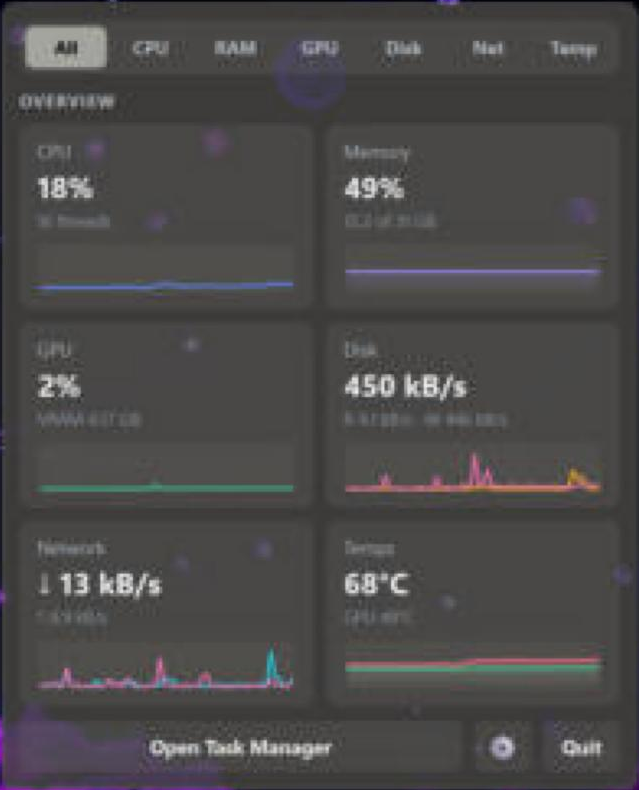
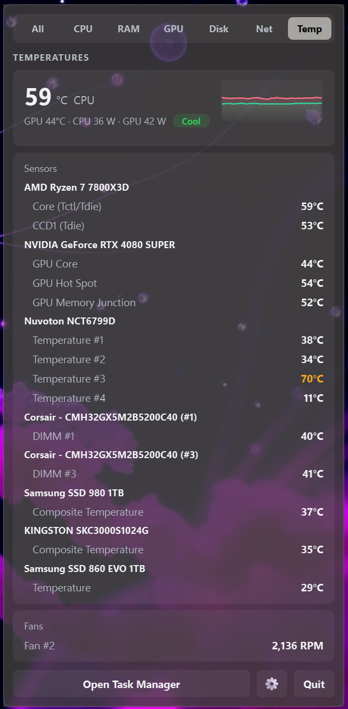
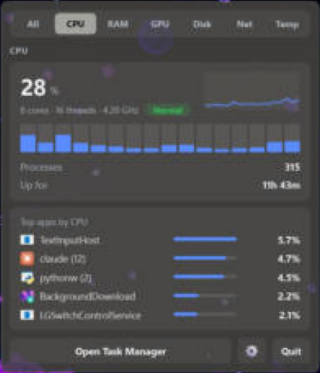
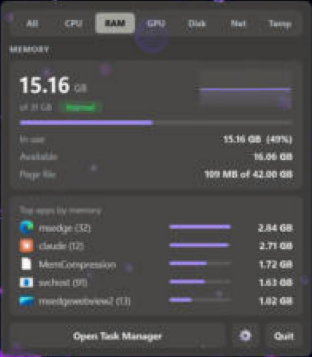
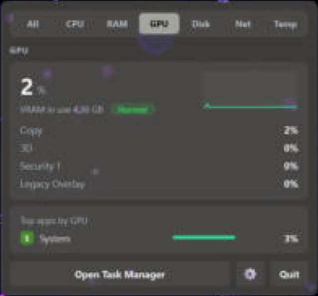
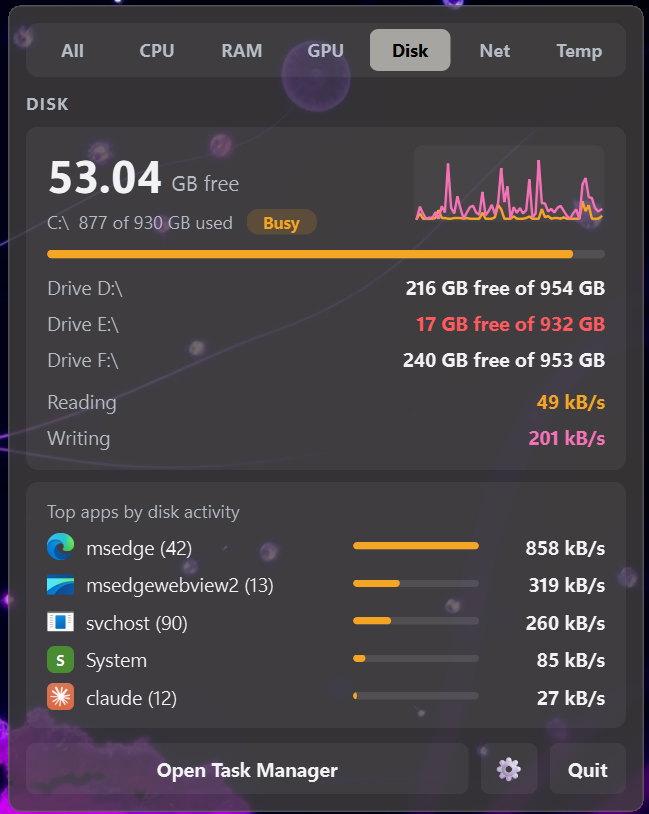
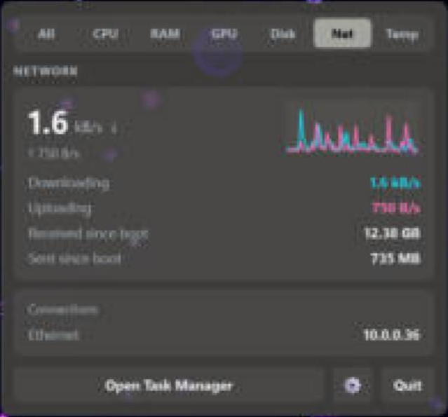

# Glance

A lightweight system monitor that lives in your Windows 11 tray. Click the icon
for a frosted, Start-menu-style flyout with live CPU, RAM, GPU, disk, network and
temperature readings, plus the apps behind each one. It follows your Windows
accent colour automatically.

  
  

| CPU | RAM | GPU |
|:-:|:-:|:-:|
|  |  |  |

| Disk | Network |
|:-:|:-:|
|  |  |

## Install
Download **Glance-Setup-x.y.z.exe** from the [latest release](https://github.com/zombifiedturkey/Glance/releases/latest)
and run it. Nothing else is needed: Python and everything Glance uses come bundled.
During setup you can tick:
- **Install the PawnIO driver**: needed for CPU and motherboard temperatures (GPU and
  drive temperatures work without it). It's downloaded from PawnIO's official release.
- **Start Glance when I sign in to Windows**

Windows SmartScreen may warn that the installer is from an unknown publisher, because
it isn't code-signed. Click **More info → Run anyway**.

Prefer no installer? Grab **Glance-x.y.z-portable.zip**, unzip it anywhere and run
`Glance.exe`.

### Running from source
1. Install Python 3.10+ from python.org (tick "Add python.exe to PATH").
2. Double-click **Install.bat**, then **Install-Temps.bat** for temperatures.
3. Double-click **Start Glance.bat**.

Windows 11 hides new tray icons under the ^ arrow. To keep Glance visible, drag
its icon onto the taskbar, or turn it on in Settings > Personalization >
Taskbar > Other system tray icons.

## Temperatures (running from source)
Temperatures work like HWMonitor: reading the sensors needs admin rights and a
small signed driver.
1. Double-click **Install-Temps.bat**. It installs `pythonnet` and downloads the
   open-source LibreHardwareMonitor library from its official GitHub release into
   this folder. Then it opens LibreHardwareMonitor once: approve the prompt and
   accept the PawnIO driver if offered.
2. In Glance, open the **Temp** tab and click **Enable temperatures**.

From then on, Glance shows Windows' permission prompt each time it starts, just
like HWMonitor. Say no and everything except temperatures still works. You can
turn it off with right-click > "Read temperatures".

How it works: a small sensor reader runs with admin rights and hands readings to
the normal, non-admin panel. It stops automatically when Glance quits.

## Using it
- **Left-click** the icon to open or close the panel. Esc closes it; keys 1-8 switch tabs.
- **All** shows tiles for everything. Click a tile to jump to its tab.
- Readings turn red under strain (CPU >= 85%, RAM >= 90%, GPU >= 90%, or 90 C and up). The tray icon turns red too.
- Temperatures turn amber from 70 C and red from 85 C.
- **Right-click** the icon, or use the gear, for:
  - Tray icon shows: Pulse / CPU % / Memory %
  - Start with Windows
- Per-app numbers are only collected while the panel is open, so it stays light in the background.

## Look
The panel uses the same frosted acrylic material as the Windows 11 Start menu,
tinted with your Start menu colour. The selected tab and the tray icon use your
Windows accent colour, and Glance follows accent changes live (it checks every
2 seconds), so it always matches Start.

To tweak it, create `glance-config.json` in this folder, e.g.
`{"tint_alpha": 0.7}` (lower = more see-through), `{"corners": "square"}` for
square corners, or `{"backdrop": "none"}` for the plain solid panel. Restart Glance after changing it.

## Notes
- GPU readings come from the same Windows performance counters Task Manager uses.
  If those are unavailable, the GPU tab is hidden.
- The panel opens below the icon when your taskbar is at the top, and above it when it's at the bottom.
- If something goes wrong, details are written to `glance-error.log` in this folder.
